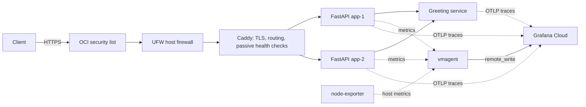
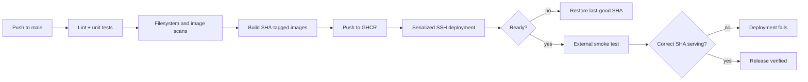

# Single-VM SRE Platform

**A production-like reliability engineering system running on one resource-constrained OCI VM.** It demonstrates infrastructure as code, safe delivery, SLO-based monitoring, distributed observability, failure testing, and incident response without hiding the limits of a single-node design.

[](https://github.com/E-Vanika/single-vm-sre-platform/actions/workflows/ci.yml)
[](https://github.com/E-Vanika/single-vm-sre-platform/actions/workflows/Terraform.yaml)
[](LICENSE)

## Reliability controls at a glance

| SRE capability | Implemented evidence |
|---|---|
| Infrastructure as code | Terraform provisions OCI networking, firewall rules, and compute; pull requests produce a reviewed plan before an environment-gated apply |
| Configuration management | Ansible bootstraps Docker, UFW, swap, and unattended security upgrades on a fresh Ubuntu host |
| Release safety | Immutable Git-SHA image tags, serialized deployments, readiness gate, deterministic rollback, and an external smoke test that verifies the serving revision |
| Observability | RED application metrics, USE host metrics, bounded-cardinality labels, Grafana dashboards, and OpenTelemetry traces across two services |
| Reliability management | 99.0% availability SLO, 30-day error budget, documented multi-window burn-rate policy, escalation policy, and operator runbooks |
| Resilience | Two application processes behind Caddy, container restart policies, resource limits, and controlled process/CPU/memory/disk failure drills |
| Security | Restricted SSH, OCI security list + UFW, automatic TLS, protected metrics, non-root application containers, dependency/image scanning, and bounded proxy trust |

> **Design boundary:** two containers on one VM provide process-level redundancy, not host or availability-zone redundancy. The service therefore does not claim high availability or “production-grade” status.

## Architecture



Everything except ports 80/443 stays on a private Docker bridge. Application containers are not bound directly to the host.

## Delivery path



The pipeline deploys the exact commit tested by CI, never a floating `latest` tag. See [CI](.github/workflows/ci.yml), [CD](.github/workflows/cd.yml), and [manual rollback](scripts/rollback.sh).

## SLO and error budget

- **Availability SLI:** proportion of user requests returning a non-5xx response.
- **Availability SLO:** 99.0% over a rolling 30-day window.
- **Latency SLO:** 95% of user requests complete in under 500 ms over 30 days.
- **Fast burn:** page when a 14.4x burn rate persists across short and long windows.
- **Slow burn:** create a follow-up when a 3x burn rate persists across short and long windows.

The target reflects the actual architecture: a single VM and availability zone cannot honestly promise 99.9%+. Budget exhaustion freezes non-reliability changes until the service returns within objective. Definitions and PromQL are in [docs/slo.md](docs/slo.md).

## Observability

The application exports request rate, error rate, and latency histograms. Route templates—not raw URLs—are used as metric labels, keeping cardinality bounded. `node-exporter` supplies CPU, memory, swap, filesystem, and load signals; `vmagent` forwards them off-host so loss of the VM does not also destroy monitoring history.

`/greet` makes a real downstream call to `greeting-service`. OpenTelemetry propagates trace context across that boundary, allowing end-to-end latency to be split between caller and dependency.


Dashboard source: [sre-grafana-dashboard.json](sre-grafana-dashboard.json). Additional evidence is collected in [docs/screenshots](docs/screenshots/screenshots-of-work.md).

## Incident response evidence

The repository records failures as engineering evidence instead of presenting only the final state:

| Incident | Signal and diagnosis | Corrective action |
|---|---|---|
| Caddy crash loop | Container logs showed an unregistered `rate_limit` directive | Removed plugin-only configuration from the stock image path and documented the image dependency |
| Bootstrap race | `apt` lock failures correlated with unfinished cloud-init | Added an explicit `cloud-init status --wait` gate |
| Metrics outage | Network inspection exposed incompatible Docker network modes and bridge isolation | Put the exporter and collector on one internal bridge |
| False-positive deployment | Readiness passed while `/status` still reported `dev` | Propagated the immutable image tag as `APP_VERSION` and verified it externally |

Operator procedures are in [docs/runbook.md](docs/runbook.md). A completed, blameless analysis is in [docs/postmortems/caddy-crash-loop.md](docs/postmortems/caddy-crash-loop.md).

## Controlled failure drills

[`scripts/chaos-test.sh`](scripts/chaos-test.sh) exercises four bounded scenarios:

| Scenario | Reliability question |
|---|---|
| `kill-app` | Does the restart policy restore a terminated application process? |
| `cpu-spike` | Do latency and saturation signals reveal CPU contention? |
| `fill-disk` | Does disk monitoring warn before filesystem exhaustion? |
| `oom` | Does a memory-limited container fail and recover predictably? |

Fault endpoints are disabled by default and Caddy explicitly returns 404 for `/_chaos/*`. Set `CHAOS_ENABLED=true` only for a controlled drill executed from the internal Docker network.

## Repository map

```text
app/                    FastAPI services, instrumentation, and tests
Terraform/              OCI network and compute infrastructure
ansible/                Idempotent host bootstrap
.github/workflows/      CI, CD, Terraform, and bootstrap automation
caddy/                  TLS termination and reverse proxy configuration
vmagent/                Prometheus-compatible scrape configuration
scripts/                Failure drills and manual rollback
docs/                   Architecture, SLOs, runbooks, and postmortems
```

## Run locally

Prerequisites: Docker with the Compose plugin.

```bash
cp .env.example .env
# Set GHCR_OWNER and use an image tag that exists in GHCR.
docker compose up -d
curl -fsS http://localhost/readyz
curl -fsS http://localhost/status
```

For a fresh cloud deployment, provision with Terraform, run the Ansible bootstrap workflow, create `/opt/solo-sre/.env` from `.env.example`, and trigger CI/CD. Secrets remain in GitHub environments and the VM-local `.env`; they are not committed.

## Deliberate tradeoffs

| Common large-scale choice | Choice here | Reason |
|---|---|---|
| Kubernetes | Docker Compose | One node does not need a cluster scheduler; this keeps the reliability mechanisms visible |
| Service mesh | Caddy | Edge TLS, routing, load balancing, and passive health checks without sidecars |
| Self-hosted Prometheus/Grafana | vmagent + Grafana Cloud | Preserves scarce RAM and keeps telemetry off-host |
| Multi-AZ replicas | Two local app processes | Recovers process failures, while explicitly accepting VM/AZ failure risk |

This is cost-aware engineering, not an assertion that simpler components provide every guarantee of their large-scale counterparts.

## Live evidence

Free-tier infrastructure may occasionally be unavailable.

- [Live service](https://solo-sre-pg.duckdns.org/)
- [Readiness](https://solo-sre-pg.duckdns.org/readyz)
- [Deployed version](https://solo-sre-pg.duckdns.org/status)
- [API documentation](https://solo-sre-pg.duckdns.org/docs)
- [Grafana dashboard](https://merrycanary2243.grafana.net/d/vak4trs/solo-sre?from=now-1h&to=now&timezone=browser&refresh=30s)
- [SonarCloud](https://sonarcloud.io/organizations/e-vanika/projects)

## Roadmap

- Replace the static deployment key with short-lived SSH certificates.
- Replace the static OCI API credential with workload identity federation.
- Record measured MTTD/MTTR and error-budget consumption for every future failure drill.
- Add a separately tested Kubernetes deployment only when a multi-node environment exists to justify it.
